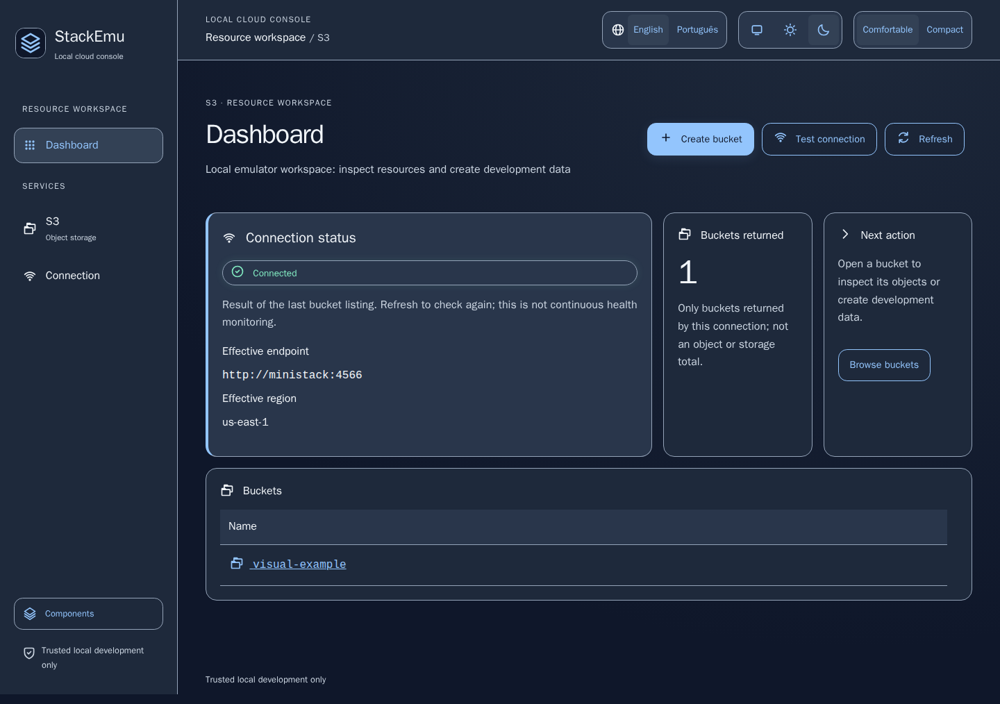
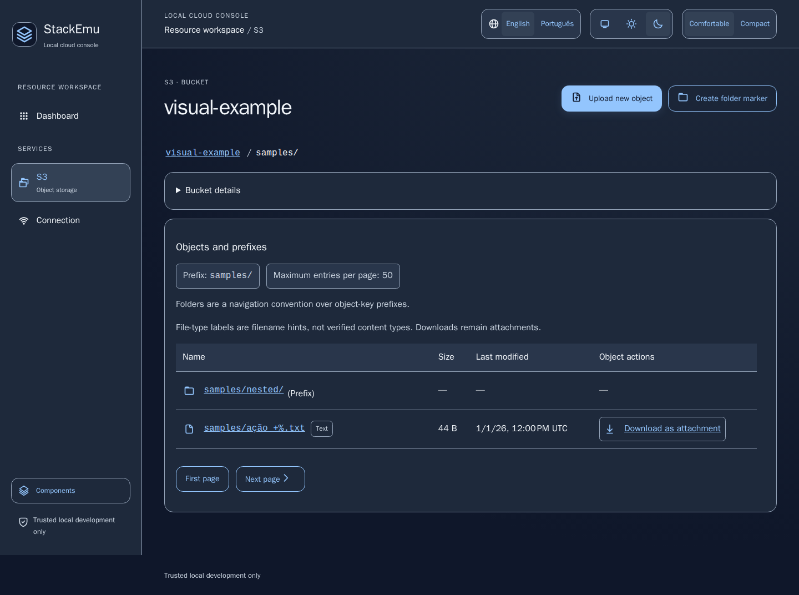

# StackEmu

A local cloud-service manager built with Java 25, Quarkus, Qute and htmx. S3 is the first implemented service.

[Português (Brasil)](README.pt-BR.md) · [Documentation](docs/README.md) · [Current status](docs/status.md)

## Service entry — 2026-10-20

Home is now a service catalog without emulator calls. Open S3 at `/s3`; its bucket listing and `/connection` diagnostic run on demand. Status on Home is always “Not verified”, not global health. Existing `/#bucket-panel` bookmarks open Home, not buckets. Contributor gallery: `/components` remains directly accessible, outside product navigation. [Decision](docs/decisions/ADR-0020-service-catalog-navigation.md).

Current catalog implementation and local checks: [service-catalog evidence](docs/evidence/service-catalog-results.md). Final Linux/new-image comparison and maintainer acceptance remain pending.

Previous UI-only operational-shell refinement: [native preferences and contextual-action evidence](docs/evidence/quiet-shell-results.md). Existing actions are easier to reach; deletion, copy/move and presigning are still pending functional work, not completed by this UI slice.

## Single-object deletion — 2026-10-20

Object Actions, full details and the drawer now offer native exact-object deletion review. Confirmation is one-use, expires after five minutes and requires CSRF; versioned/unknown buckets and folder markers are refused. [Contract](docs/decisions/ADR-0021-single-object-deletion.md) · [Local evidence and remaining gates](docs/evidence/single-object-deletion-results.md). Bulk/prefix deletion, bucket empty/delete, copy/move and signing remain unfinished.

## Previous consolidated status — 2026-10-17

`0.1.0-SNAPSHOT`, in development; no release approval. Implemented: bucket/object browsing, prefixes/pagination, bucket/folder creation, bounded single-file upload, original attachment download, metadata drawer, bucket/key clipboard, upload progress, notifications and bounded text/PNG/JPEG previews. Deletion, copy/move and presigned URLs remain first-delivery requirements, not implemented capabilities.

Latest consolidated verification: **107 Java tests and 157 pinned-Linux browser scenarios passed**, including 80 reviewed PNG comparisons against a fresh Linux/amd64 image, 128 MiB streaming with a 64 MiB heap and zero image-scan findings reported by the available databases. V4 was validated by the maintainer. [V6 evidence and limits](docs/evidence/visual-v6-results.md) preserve the initial failures, test-fixture fixes, database dates and pending human/immutable-commit/release gates. Daily execution is restored to host Java with only MiniStack in Docker; no release or publication is approved.

## Preview

Historical pre-catalog dashboard/bucket presentation fixtures from the versioned Linux visual baselines (not yet reconciled for the service-entry change), not live account data or screenshots of every current capability. Examples do not constitute human design/accessibility approval.





## Quick start — local JVM

From the repository root: install Java 25, Maven and Docker Desktop/Engine with Compose v2. Maven provisions pinned Node/npm build tools. Defaults: local MiniStack at `http://localhost:4566` and development-only `test` credentials. Remove any production `STACKEMU_*` overrides first.

```sh
docker compose up -d --no-deps ministack --wait
mvn -B -ntp package -DskipTests
java -Xmx384m -XX:ActiveProcessorCount=2 -jar target/quarkus-app/quarkus-run.jar
```

Open [StackEmu locally](http://127.0.0.1:8080/). The second command builds; it does **not** run tests. Daily development/testing uses the host JVM and local tools; Docker runs only the S3 emulator, with the GUI container stopped. New-image/container verification is reserved for the final stage. [Configuration](docs/configuration.md) · [Testing](docs/development/testing.md).

Stop Java with Ctrl+C; stop only the emulator with `docker compose stop ministack`. Named volumes retain development data. If 8080 is occupied, stop the previous local GUI first. The commands combine previously exercised operations; this exact three-command onboarding sequence still awaits an independent clean-user walkthrough. Linux/macOS onboarding is not claimed verified.

## Limits and safety

- Trusted local development only; no user authentication. Keep ports on loopback; never expose the GUI to the internet or target production resources.
- MiniStack 1.5.25/amd64 is the tested reference; full S3, ARM64 and other emulator/browser compatibility are not certified.
- Single-file upload defaults to 10 MiB; text preview to 64 KiB; static PNG/JPEG preview to 1 MiB input/output and documented image limits. No HTML/SVG/PDF/animated-image preview.
- Deletion, overwrite, copy/move, presigning, versions and resumable transfers are not available in the GUI. Original download name/type/bytes remain separate from sanitized preview output.
- Legal/name validation, human accessibility, independent onboarding, candidate-image scan/verification and explicit release approval remain pending.

## Documentation and contribution

[Documentation index](docs/README.md) groups usage, contribution, decisions and evidence. [Status](docs/status.md) is the current snapshot; [history](docs/history.md) preserves phase context. See [S3 scope](docs/product/s3-management-scope.md), [limitations](docs/known-limitations.md), [SECURITY](SECURITY.md) and [CONTRIBUTING](CONTRIBUTING.md).

Quarkus 3.40.1/Qute, AWS SDK through the platform BOM, local htmx and build-only Tailwind without Preflight; Node is not a production server. The application is MIT licensed; adapted coolicons use CC BY 4.0 separately. See [LICENSE](LICENSE), [third-party notices](THIRD_PARTY_NOTICES.md) and [code of conduct](CODE_OF_CONDUCT.md).

`StackEmu` legal/registry/domain/INPI validation is pending. No affiliation with AWS, MiniStack, LocalStack or Moto is implied.
