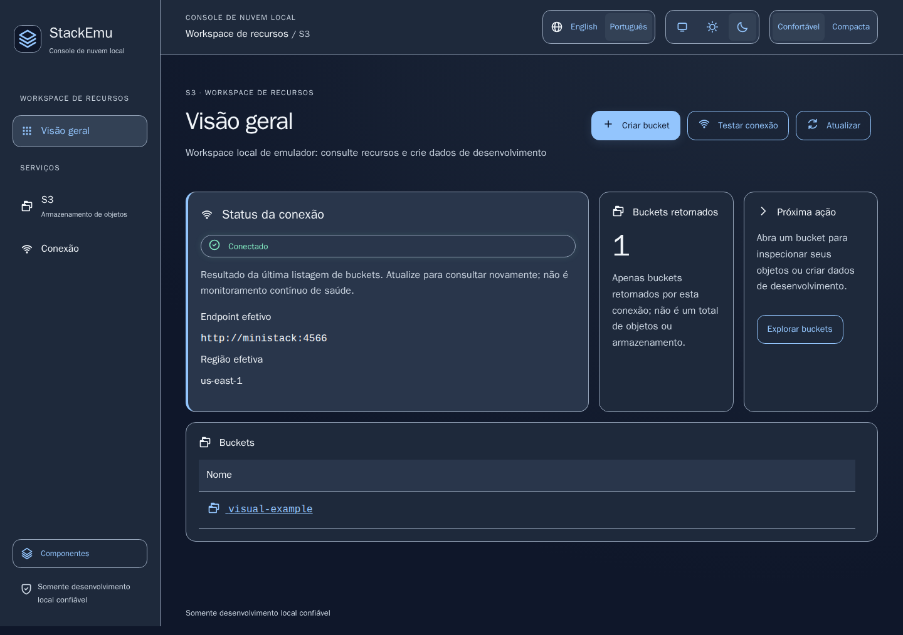
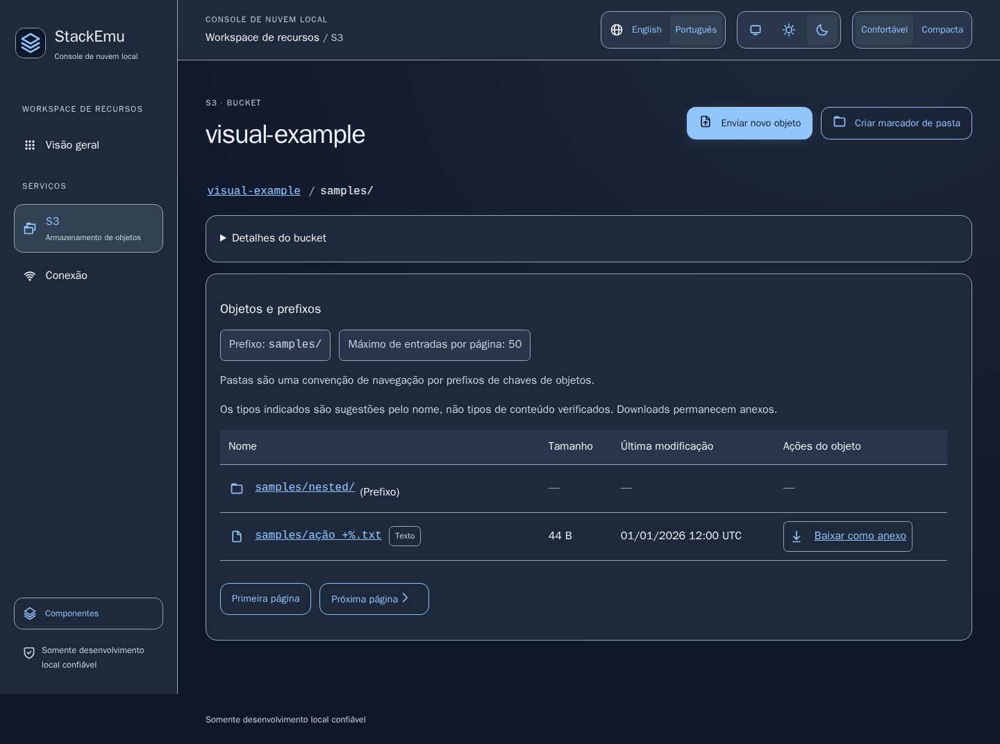

# StackEmu

Gerenciador local de serviços de nuvem desenvolvido com Java 25, Quarkus, Qute e htmx. S3 é o primeiro serviço implementado.

[English](README.md) · [Documentação](docs/README.md) · [Status atual](docs/status.md)

## Central de serviços — 2026-10-20

Início agora é um catálogo sem consultas ao emulador. Abra S3 em `/s3`; listagem e diagnóstico `/connection` consultam sob demanda. Status em Início é sempre “Não verificado”, não saúde global. Favoritos `/#bucket-panel` abrem Início, não buckets. Galeria para contribuição: `/components`, acessível diretamente e fora do menu de produto. [Decisão](docs/decisions/ADR-0020-service-catalog-navigation.md).

Implementação da central e verificações locais atuais: [evidência da central](docs/evidence/service-catalog-results.md). Comparação final Linux/imagem nova e aceite do mantenedor continuam pendentes.

Refinamento anterior, somente de UI: [preferências nativas e ações contextuais](docs/evidence/quiet-shell-results.md). Ações existentes mais acessíveis; exclusão, cópia/movimentação e assinatura continuam pendentes, não concluídas por esta fatia de UI.

## Exclusão individual — 2026-10-20

Ações do objeto, detalhes completos e drawer oferecem revisão nativa para exclusão do objeto exato. Confirmação de uso único, expiração de cinco minutos e CSRF; buckets versionados/desconhecidos e markers são recusados. [Contrato](docs/decisions/ADR-0021-single-object-deletion.md) · [Evidência local e gates restantes](docs/evidence/single-object-deletion-results.md). Lote/prefixo, esvaziar/excluir bucket, cópia/movimentação e assinatura seguem pendentes.

## Status consolidado anterior — 2026-10-17

`0.1.0-SNAPSHOT`, em desenvolvimento; sem aprovação de release. Implementados: navegação de buckets/objetos, prefixos/paginação, criação de buckets/pastas, upload individual limitado, download do anexo original, drawer de metadados, clipboard de bucket/chave, progresso de upload, notificações e previews limitados de texto/PNG/JPEG. Exclusão, cópia/movimentação e URLs assinadas continuam requisitos da primeira entrega, não capacidades implementadas.

Última verificação consolidada: **107 testes Java e 157 cenários de navegador Linux fixado passaram**, incluindo 80 comparações PNG revisadas contra imagem Linux/amd64 nova, streaming de 128 MiB com heap de 64 MiB e zero achados reportados pelas bases disponíveis no scan da imagem. V4 validada pelo mantenedor. [Evidência V6 e limites](docs/evidence/visual-v6-results.md) preservam falhas iniciais, correções de fixtures, datas das bases e gates humanos/commit imutável/release pendentes. Fluxo diário restaurado à JVM local com somente MiniStack no Docker; sem aprovação de release/publicação.

## Prévia

Fixtures históricas do dashboard/bucket anteriores à central de serviços, obtidas dos baselines Linux versionados; reconciliação final ainda pendente. Não são dados de conta real nem capturas de todas as capacidades atuais. Exemplos não equivalem a aceite humano de design/acessibilidade.





## Início rápido — JVM local

Na raiz do repositório: instalar Java 25, Maven e Docker Desktop/Engine com Compose v2. Maven provisiona Node/npm fixados para o build. Padrões: MiniStack local em `http://localhost:4566` e credenciais `test` somente de desenvolvimento. Remover primeiro overrides `STACKEMU_*` de produção.

```sh
docker compose up -d --no-deps ministack --wait
mvn -B -ntp package -DskipTests
java -Xmx384m -XX:ActiveProcessorCount=2 -jar target/quarkus-app/quarkus-run.jar
```

Abrir [StackEmu local](http://127.0.0.1:8080/?lang=pt-BR). O segundo comando compila; ele **não** executa testes. Desenvolvimento/testes diários usam JVM e ferramentas locais; Docker executa somente o emulador S3, com a GUI em contêiner parada. Verificação de imagem nova/contêiner fica para a etapa final. [Configuração](docs/configuration.md) · [Testes](docs/development/testing.md).

Encerrar Java com Ctrl+C; parar somente o emulador com `docker compose stop ministack`. Volumes nomeados preservam dados de desenvolvimento. Se 8080 estiver ocupada, encerrar primeiro a GUI anterior. Os comandos combinam operações já exercitadas; a sequência exata de três comandos ainda exige walkthrough independente por pessoa sem contexto. Onboarding Linux/macOS não é declarado verificado.

## Limites e segurança

- Somente desenvolvimento local confiável, sem autenticação de usuários. Manter portas em loopback; nunca expor a GUI à internet nem usar recursos de produção.
- MiniStack 1.5.25/amd64 é a referência testada; S3 completo, ARM64 e outros emuladores/navegadores não são certificados.
- Upload individual padrão até 10 MiB; preview de texto até 64 KiB; PNG/JPEG estáticos até 1 MiB de entrada/saída e limites de imagem documentados. Sem preview HTML/SVG/PDF/imagens animadas.
- Exclusão, sobrescrita, cópia/movimentação, assinatura, versões e transferências retomáveis não estão disponíveis na GUI. Nome/tipo/bytes do download original permanecem separados da prévia sanitizada.
- Validação jurídica/do nome, acessibilidade humana, onboarding independente, scan/verificação da imagem candidata e aprovação explícita de release continuam pendentes.

## Documentação e contribuição

[Índice de documentação](docs/README.md) agrupa uso, contribuição, decisões e evidências. [Status](docs/status.md) é o retrato atual; [histórico](docs/history.md) preserva contexto das fases. Consultar [escopo S3](docs/product/s3-management-scope.md), [limitações](docs/known-limitations.md), [SECURITY](SECURITY.pt-BR.md) e [CONTRIBUTING](CONTRIBUTING.pt-BR.md).

Quarkus 3.40.1/Qute, AWS SDK pelo BOM da plataforma, htmx local e Tailwind somente no build sem Preflight; Node não é servidor de produção. Aplicação sob MIT; coolicons adaptados usam CC BY 4.0 separadamente. Consultar [LICENSE](LICENSE), [notices de terceiros](THIRD_PARTY_NOTICES.md) e [código de conduta](CODE_OF_CONDUCT.pt-BR.md).

Validação jurídica/registros/domínio/INPI de `StackEmu` pendente. Sem afiliação implícita com AWS, MiniStack, LocalStack ou Moto.
