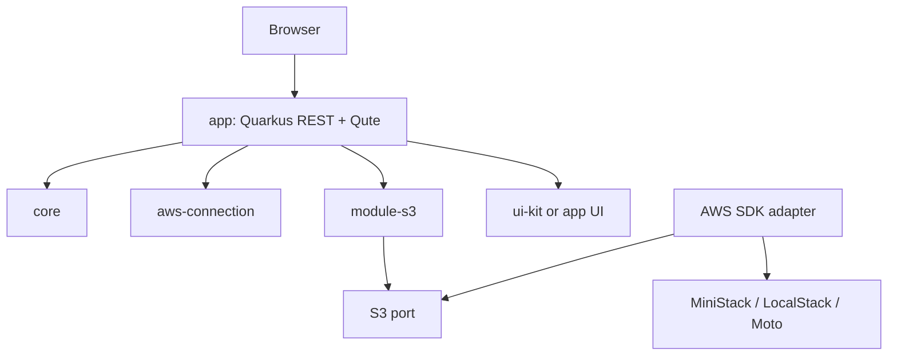

# Architecture overview / Visão de arquitetura

Current operation architecture follows [ADR-0029](../decisions/ADR-0029-minimal-workspace-operations.md): web resources use application operation contracts, a bounded AWS worker executes reviewed mutations, and `adapter.persistence` commits inventories/results to embedded H2. Status reads use the local journal, not emulator health calls. The application remains one Maven module; [operation contracts](../development/s3-operations.md) describe restart, endpoint binding and concurrency. / Arquitetura atual usa contratos de operações, worker AWS limitado e persistência H2; status consulta histórico local. Um módulo Maven, com reinício/vínculo ao endpoint/concorrência documentados.

## Logical design / Desenho lógico

Current web entry, 2026-10-20: [ADR-0020](../decisions/ADR-0020-service-catalog-navigation.md) separates `HomeResource` (catalog, no service I/O), `BucketsResource` (`/s3` page) and `BucketListFragmentResource` (existing `/buckets` read fragment). The latter two use the existing bucket-list port; no generic registry or application module is introduced. `/connection` remains S3-specific, not a global health service. The proposed logical diagram below is not a map of implemented Maven modules. / Entrada atual separa catálogo sem I/O, página S3 e fragmento existente, reutilizando o port sem novo módulo/catálogo genérico. Diagnóstico é S3, não saúde global; diagrama proposto abaixo não representa módulos implementados.

The application uses Quarkus REST and Qute for server rendering, with htmx/JavaScript for partial interactions. Normal GUI traffic goes through the application; an explicitly generated presigned download addresses the configured emulator directly when used. The app composes connection configuration, S3 use cases, UI, and an AWS SDK adapter. The historical diagram below is a logical proposal, not the implemented Maven module tree.

A GUI conversa com a aplicação; usar um download assinado gerado explicitamente acessa diretamente o emulador configurado. A aplicação compõe configuração, casos de uso S3, UI e adaptador AWS. O diagrama histórico é proposta lógica, não a árvore atual de módulos.

## Rules / Regras

- Domain rules must not import Quarkus, Qute, or AWS SDK classes.
- Dependencies point inward; web view models are separate from domain models.
- SDK exceptions are translated to stable application errors: unavailable connection, not found, unsupported operation, validation, and unexpected failure.
- Generalize only when a second real implementation requires it.
- Emulator detection is evidence-based convenience, never proof of compatibility.

## Open validation / Validação em aberto

Validate Quarkus extension names/BOM/toolchain, AWS endpoint override and path-style behavior, CDI/Jandex behavior for libraries, Qute template collisions, htmx CSRF/error/history behavior, and container-to-container networking. See [spikes](../evidence/).
