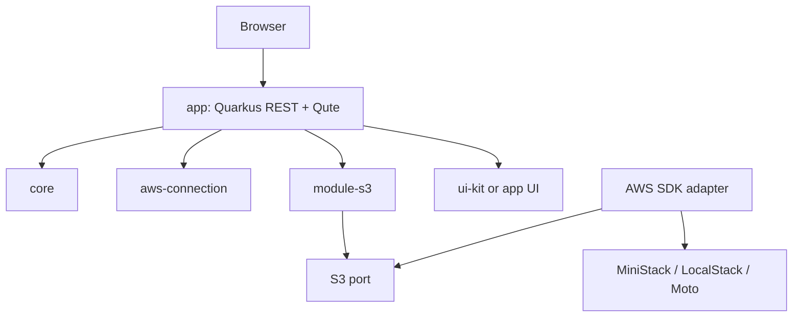

# Architecture overview / Visão de arquitetura

## Logical design / Desenho lógico

The proposed application uses Quarkus REST and Qute for server rendering; htmx is limited to useful partial interactions. The browser talks to the app, not directly to the emulator. The app composes connection configuration, S3 use cases, UI, and an AWS SDK adapter. This is a logical boundary map, not proof that each component should be a Maven module on day one.

O navegador conversa com a aplicação, não diretamente com o emulador. A aplicação compõe configuração, casos de uso S3, UI e adaptador AWS. Esse é um mapa lógico; a separação em módulos Maven depende do spike da Fase 0.

## Rules / Regras

- Domain rules must not import Quarkus, Qute, or AWS SDK classes.
- Dependencies point inward; web view models are separate from domain models.
- SDK exceptions are translated to stable application errors: unavailable connection, not found, unsupported operation, validation, and unexpected failure.
- Generalize only when a second real implementation requires it.
- Emulator detection is evidence-based convenience, never proof of compatibility.

## Open validation / Validação em aberto

Validate Quarkus extension names/BOM/toolchain, AWS endpoint override and path-style behavior, CDI/Jandex behavior for libraries, Qute template collisions, htmx CSRF/error/history behavior, and container-to-container networking. See [spikes](../spikes/).
